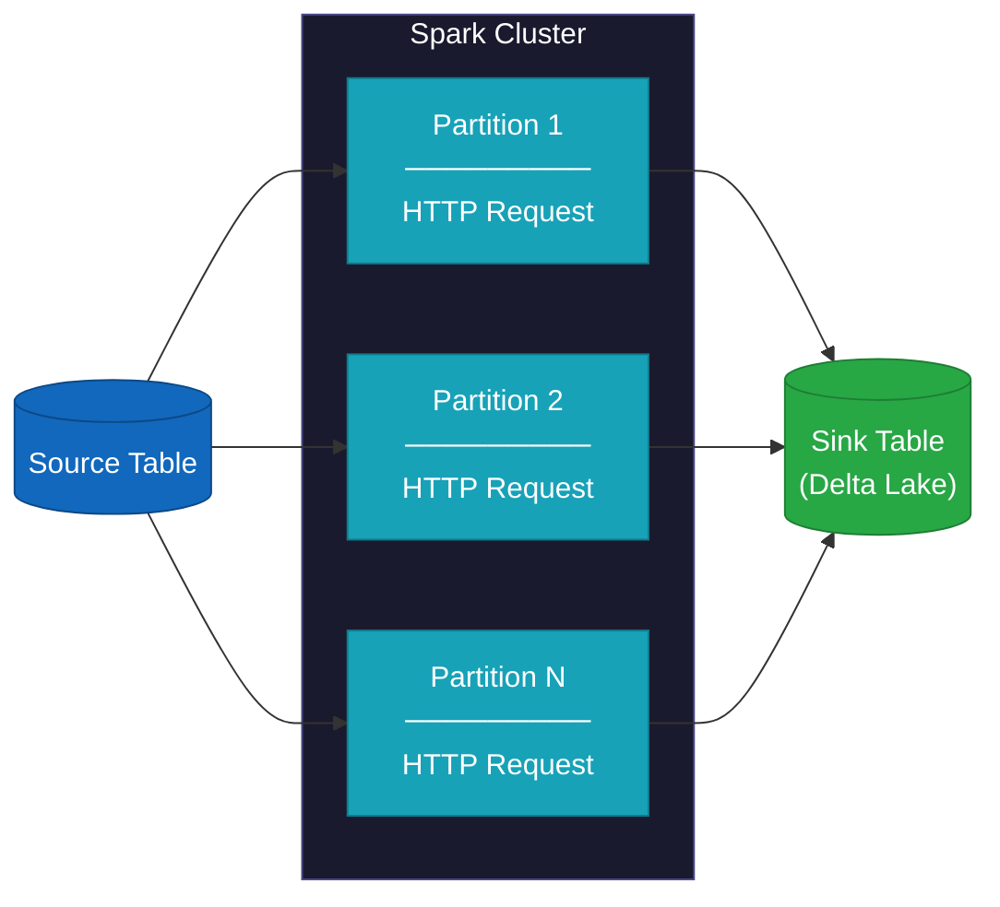
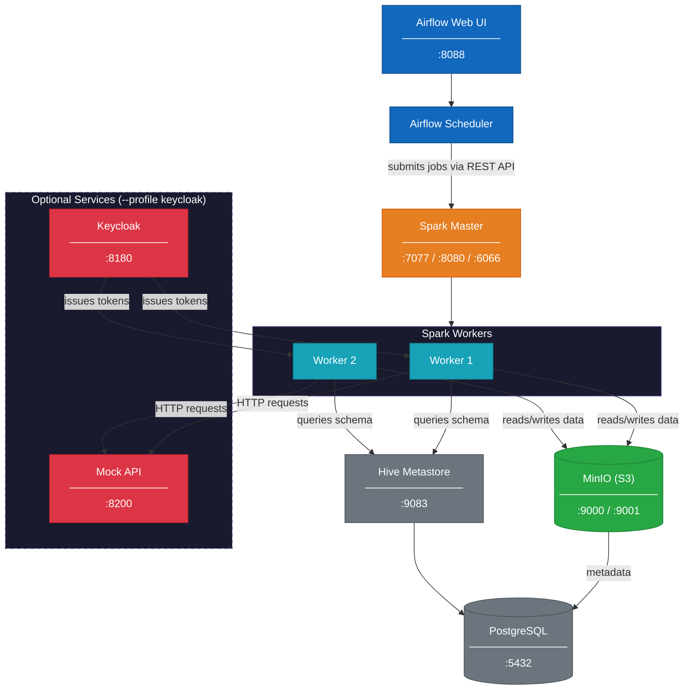

# Spark API-Driven ETL Framework

## Overview
Sending millions of rows to a REST API is deceptively hard in distributed compute platforms like Spark. A naive driver-only loop does not scale. Multithreaded workers using synchronous `requests` waste memory on idle OS threads. Refreshing OAuth2 tokens becomes a challenge due to broadcast variable limitations or hitting token checkout limits on the host server.

This framework solves all of that. It's a production-grade, configuration-driven Spark ETL application that distributes HTTP requests across a Spark cluster, achieves concurrency within each worker via `asyncio` and `aiohttp`, and manages long-lived authentication with a driver-side OAuth2 RPC service that keeps tokens fresh across every worker for the lifetime of the job.

The framework runs on a fully containerized local platform orchestrated with Docker Compose — a Spark cluster with multiple workers, Delta Lake storage backed by MinIO, a Hive Metastore, Airflow for job orchestration, Keycloak for OAuth2, and a mock API server. Clone the repo, build the images, start the stack, and the entire platform is live. Pipelines can be triggered via Airflow DAGs, Jupyter notebooks, or the CLI.

Pipelines are defined entirely in YAML or JSON — endpoint, authentication strategy, middleware, and source/sink tables — and validated at startup with Pydantic before a single Spark job is submitted. Adding a new pipeline requires no code changes.

## Who This Is For

This framework is built for data engineers working with APIs at scale — where a single requests.get() in a loop stopped being acceptable long ago, but the right distributed solution isn't obvious.

It fits naturally as the bronze layer of an API-sourced pipeline: each row in a source table becomes a parameterized HTTP request, and each response lands in a Delta table ready for downstream transformation. The framework handles the hard parts — cluster-wide concurrency, token lifecycle management, partial failure recovery, and idempotent re-execution — so pipeline authors only need to write YAML.

If your data lives behind a REST API and you need to move it into a lakehouse reliably and at scale, this is the pattern.

The repository also works as a self-contained example of running a multi-worker Spark cluster, with storage, a metastore, and orchestration, on a single workstation.

## How It Works
Each row in a source table becomes a parameterized HTTP request. The framework partitions the source data across Spark workers, where each partition processes its rows concurrently using an asyncio producer-consumer queue. Responses are collected and written to a Delta Lake sink table alongside request metadata, status codes, and error details.



## Key Features

* **Spark-native execution** - Distributes API requests across workers via `mapPartitions`
* **Configuration-driven** - Define pipelines in YAML with strict Pydantic validation
* **Multiple auth patterns** - None, Basic, Bearer, OAuth2 (password & client credentials)
* **Pluggable middleware** - Retries, logging, timing, auth injection, request mutation
* **Idempotent processing** - Track requests with IDs for fault-tolerant execution
* **Worker-side execution** - Fully serialized runtime behavior for Spark safety


## Requirements

### Tools

To run the platform:

| Tool | Notes |
|---|---|
| Linux, or Windows with WSL2 | Tested on Linux and WSL2 (Ubuntu). macOS and ARM64 (Apple Silicon) are untested. |
| Docker Engine with Docker Compose v2 | The `docker compose` plugin, not the legacy `docker-compose` binary. Your user must be able to run `docker` without `sudo` (be in the `docker` group). |
| GNU Make | Every command in this README goes through the `Makefile`. |
| git | To clone the repository. |

For local development only (running tests, linting, type checking on the host):

| Tool | Notes |
|---|---|
| [uv](https://docs.astral.sh/uv/) | Manages the Python version and virtual environment. See [Local Development](#local-development). |

Running the demos needs **no local Python**: everything runs inside containers.

### Hardware

| | Minimum / default | Notes |
|---|---|---|
| CPU | 8 physical cores | Count physical cores with `lscpu`, not `nproc`. See [Cluster Sizing](docs/cluster-sizing.md#physical-cores). |
| Memory | 16 GB available to Docker | On WSL2, Linux gets 50% of Windows RAM by default. See [WSL2 memory limit](docs/cluster-sizing.md#wsl2-memory-limit). |
| Disk | ~30 GB free | The built images take ~18 GB, plus build cache and data volumes. |

The default cluster settings assume 8 cores and 16 GB. With more resources you can run a larger cluster;
see [Sizing the Cluster](#sizing-the-cluster).

Tested on:

- 8 cores / 32 GB (the original development workstation)
- Intel Core Ultra 7 265H (16 cores: 6 performance + 8 efficient + 2 low-power efficient), WSL2 with ~16 GB available to Docker

### Ports

The stack publishes these ports on `localhost`. If something else on your machine already uses one,
`make up-*` fails with `port is already allocated`. Check with `ss -ltn` and stop the conflicting
program (a local PostgreSQL on 5432 and a local Jupyter on 8888 are the usual suspects).

| Port | Service | Started by |
|---|---|---|
| 5432 | PostgreSQL | all `up` targets |
| 6066 | Spark REST API (job submission) | all `up` targets |
| 7077 | Spark master | all `up` targets |
| 8080 | Spark master UI | all `up` targets |
| 8088 | Airflow UI | all `up` targets |
| 9000 / 9001 | MinIO S3 API / console | all `up` targets |
| 9083 | Hive Metastore | all `up` targets |
| 8888 | Jupyter | `up-jupyter`, `up-demo`, `up-all` |
| 8180 | Keycloak | `up-keycloak`, `up-demo`, `up-all` |
| 8200 | Mock API | `up-keycloak`, `up-demo`, `up-all` |
| 18080 | Spark History Server | `up-history`, `up-all` |

## Quick Start

### 1. Build the images

```bash
make build-demo
```

This builds the Spark, Airflow, Hive, Jupyter, and mock API images. The first build downloads about
6 GB of base images and libraries, so expect **10–20 minutes** depending on your connection. Once
the base images are cached, a full rebuild takes about 4 minutes.

You only need to rebuild when Dockerfiles or `docker/requirements.txt` change. The `src/`, `dags/`,
`configs/`, and `notebooks/` directories are mounted into the containers, so code and config
changes are picked up without a rebuild.

### 2. Start the platform

```bash
make up-demo
```

`up-demo` starts the core platform plus Jupyter, Keycloak, and the mock API that the demos call.
Startup takes about 1–2 minutes while services wait for each other's health checks. Other targets
start smaller or larger sets of services:

| Target | Starts |
|---|---|
| `make up` | Core platform: PostgreSQL, MinIO, Hive Metastore, Spark master + workers, Airflow |
| `make up-jupyter` | Core + Jupyter |
| `make up-keycloak` | Core + Keycloak + mock API |
| `make up-history` | Core + Spark History Server |
| `make up-demo` | Core + Jupyter + Keycloak + mock API (**use this for the demos**) |
| `make up-all` | Everything |

### 3. Check that it's healthy

```bash
make ps
```

When startup is complete:

- Every service with a health check shows `Up ... (healthy)`. The Spark workers
  (`distributed-api-etl-spark-worker-1`, `-2`, ...) have no health check and show plain `Up`.
- `minio-init` and `airflow-init` **don't appear**. They are one-shot setup containers that create
  the storage buckets and the Airflow database, then exit. That's expected. To see them, run
  `docker compose -f docker/docker-compose.yml -p distributed-api-etl ps -a`; they should show
  `Exited (0)`.
- `(health: starting)` means the service is still starting. Wait and run `make ps` again.
  Keycloak is usually the last one ready.

Then open these pages:

| Check | Where | Expected |
|---|---|---|
| Spark cluster | http://localhost:8080 | `Alive Workers: 2`, `Cores in use: 6 Total`, `Memory in use: 4.0 GiB Total` |
| Airflow | http://localhost:8088 (admin / admin) | Six DAGs whose names start with `demo_` |
| Jupyter | http://localhost:8888 (token `jupyter`) | JupyterLab, with the demo notebooks under `notebooks/` |
| Mock API | http://localhost:8200/health | `{"status":"healthy"}` |
| Keycloak | http://localhost:8180 (admin / admin) | Keycloak admin console |

If something isn't healthy, see `make logs SERVICE=<service>` and
[Troubleshooting](docs/running-demos.md#troubleshooting).

### Sizing the Cluster

The Spark cluster is sized with three parameters, which work with every `make up-*` target:

| Parameter | Default | Meaning |
|---|---|---|
| `WORKERS` | `2` | Number of Spark worker containers |
| `WORKER_CORES` | `3` | Task slots per worker (how many tasks it runs at once) |
| `WORKER_MEMORY` | `2G` | Memory each worker can give to Spark drivers and executors |

```bash
make sizing                                               # suggest values for this machine
make up-demo WORKERS=3 WORKER_CORES=2 WORKER_MEMORY=3G    # start or resize the cluster
```

Rules of thumb:

- Keep `WORKERS × WORKER_CORES` at or below your **physical** cores minus 2. Going over is allowed
  for these I/O-bound demos, but gives diminishing returns.
- Keep `WORKER_MEMORY` at **2G or more**, and keep `WORKERS × (WORKER_MEMORY + 1G)` within the memory
  left over after the other services (about 7 GB for `make up-demo`).
- The parallel demo DAG needs **at least 6 slots** (`WORKERS × WORKER_CORES`). With 5 or fewer it hangs.
- On one machine, prefer a few workers with 2–4 cores each over many 1-core workers.
- Make doesn't remember previous values. Pass every non-default value each time you run `make up-*`,
  or the workers are recreated with the defaults.

Running `make up-*` again with new values resizes the cluster in place: only the workers are recreated,
and any jobs running on them are killed. See [Cluster Sizing](docs/cluster-sizing.md) for the full guide:
how to find your machine's limits, how the values interact, and what the symptoms of a wrong size look like.

## What's Running

| Service | URL | Credentials | What it does |
|---|---|---|---|
| Spark master UI | http://localhost:8080 | — | Cluster status: workers, running applications, cores and memory in use |
| Airflow | http://localhost:8088 | admin / admin | Triggers and monitors the demo pipelines (DAGs) |
| Jupyter | http://localhost:8888 | token `jupyter` | Interactive demo notebooks |
| MinIO console | http://localhost:9001 | minioadmin / minioadmin | Browse the S3-compatible storage where Delta tables are written |
| Keycloak | http://localhost:8180 | admin / admin | OAuth2 identity provider used by the OAuth2 demos |
| Mock API | http://localhost:8200 | — | The REST API the demo pipelines call |
| Spark History Server | http://localhost:18080 | — | Completed Spark applications (`history` profile only) |
| Hive Metastore | `thrift://localhost:9083` | — | Table catalog (no UI) |
| PostgreSQL | `localhost:5432` | postgres / postgres | Backing database for Hive and Airflow |

See [Local Development](docs/local-development.md) for the full service reference.

## Running the Demos

Six demos call the mock API with different authentication patterns and write the responses to Delta
tables in the `demo` database. See [Running Demos](docs/running-demos.md) for the full list and details.

### Via Airflow (runs on the Spark cluster)

Airflow submits each demo to the Spark cluster, so this is the way to see the workers in action.

```bash
make dag-list                                    # list the DAGs
make dag-trigger DAG=demo_noauth_pipeline        # unpause and trigger one demo
make dag-status DAG=demo_noauth_pipeline         # check its recent runs
make dag-trigger DAG=demo_all_pipelines_parallel # run five demos at the same time
make dag-status                                  # latest run of every DAG
```

A single demo takes about a minute; the parallel DAG about 2 minutes with the default cluster.
While they run, watch http://localhost:8080 to see the applications get cores on the workers.

In the Airflow UI (http://localhost:8088), you can also toggle a DAG on and click **Trigger DAG**
(the play button), then follow it in the Grid or Graph view.

If a run fails, `make dag-logs DAG=<dag_id> TASK=<task_id>` shows the Airflow task log, and
`make driver-logs` shows the Spark driver's output from the worker it ran on.

### Via Jupyter notebooks

1. Open http://localhost:8888 (token `jupyter`).
2. Open any notebook under `notebooks/`.
3. Run all cells (**Run > Run All Cells**).

> The notebooks run Spark in local mode inside the Jupyter container, not on the cluster workers.
> They run the same pipeline code and write to the same tables. See
> [Cluster Sizing](docs/cluster-sizing.md#where-the-spark-driver-runs) for why.

### From your own code

Inside the Jupyter or Spark containers, a pipeline is one function call. The demo configs have no
source table, so you pass a DataFrame whose rows become the API requests:

```python
from pyspark.sql.functions import expr, sha2
from orchestration.orchestrator import run_pipeline

source_df = spark.range(50).select(sha2(expr("uuid()"), 256).alias("tracking_id"))

run_pipeline(
    spark=spark,
    config_path="/opt/spark/app/configs/examples/noauth_demo.yml",
    source_df=source_df,
    source_id="tracking_id",  # column that uniquely identifies each request
)
```

The notebooks in `notebooks/` are complete, runnable versions of this. See
[Configuration](docs/configuration.md) to write your own pipeline config.

## Checking Results

Each demo writes its responses to a Delta table in the `demo` database, for example
`demo.noauth_demo_response`. A successful Airflow demo run writes 100 rows with status code 200:

```bash
make spark-sql
```

```sql
SHOW TABLES IN demo;
SELECT status_code, count(*) FROM demo.noauth_demo_response GROUP BY status_code;
-- 200    100
```

Exit with `exit;`. While a `spark-sql` or `spark-shell` session is open it holds free cores on the
cluster, so exit before triggering more DAGs.

You can also browse the files in the MinIO console (http://localhost:9001, `warehouse` bucket,
`demo.db/`), or query the tables from a notebook with `spark.table("demo.noauth_demo_response")`.

## Stopping and Resetting

| Command | Containers | Data (tables, Airflow history) | Images | Use it when |
|---|---|---|---|---|
| `make restart` | Restarted in place | Kept | Kept | Something is stuck. Keeps your profiles and cluster size. |
| `make down` | Removed | Kept | Kept | You're done for now. `make up-*` brings everything back. |
| `make clean` | Removed, including orphans | Kept | Kept | After renaming or removing services in `docker-compose.yml` |
| `make clean-volumes` | Removed | **Deleted** | Kept | You want a fresh start: empty tables, new Airflow database |
| `make clean-all` | Removed | **Deleted** | Jupyter and mock API images deleted | Full reset. Run `make build-demo` before starting again. |

`make restart` doesn't apply changes. To apply new cluster sizes or `docker-compose.yml` changes, run
`make up-*` again.

## Local Development

The containers have everything needed to *run* the platform. For working on the code itself (tests,
linting, type checking), set up a local Python environment.

### With uv (recommended)

[Install uv](https://docs.astral.sh/uv/getting-started/installation/), then:

```bash
make install     # uv sync: installs Python 3.10 if needed, creates .venv, installs all dependencies
make test-unit   # unit tests (no Docker needed)
make test        # all tests
make lint        # ruff
make typecheck   # pyright
```

Run anything else in the environment with `uv run <command>`, or activate it with `source .venv/bin/activate`.

The Python version (3.10, pinned in `.python-version`) and the dependency versions match the Spark
cluster images. PySpark 3.5 doesn't support Python 3.12 or later. Dependencies are declared in
`pyproject.toml` and locked in `uv.lock`; the runtime versions must stay in sync with
`docker/requirements.txt`, which the images install. After changing dependencies, run `uv lock` and
`make requirements`.

### Without uv

`requirements.txt` is generated from `uv.lock` (`make requirements`) for tools that don't read it.

- **venv + pip:** `python3.10 -m venv .venv && source .venv/bin/activate && pip install -r requirements.txt`
- **conda:** `conda create -n distributed-api-etl python=3.10 && conda activate distributed-api-etl && pip install -r requirements.txt`

Then run the tools directly (`pytest tests/unit`, `ruff check src/ tests/`, `pyright src/`).
The `make test`/`lint`/`typecheck` targets call `uv run`, so they need uv.

## Documentation

New to the platform? Start with the [Quick Start](#quick-start) above, then [Running Demos](docs/running-demos.md).

| Document | Description |
|----------|-------------|
| [Running Demos](docs/running-demos.md) | Step-by-step guide to the six demos, checking results, and troubleshooting |
| [Cluster Sizing](docs/cluster-sizing.md) | Choosing `WORKERS`, `WORKER_CORES`, and `WORKER_MEMORY` for your machine |
| [Local Development](docs/local-development.md) | Full platform reference: Docker services, Makefile commands, ports, and credentials |
| [Architecture](docs/architecture.md) | **Start here to understand the design.** End-to-end data flow, driver vs. worker responsibilities, and why `asyncio` outperforms multithreading at cluster scale |
| [Middleware](docs/middleware.md) | The pluggable request pipeline: how auth, retries, logging, and transforms are composed without modifying core logic |
| [Configuration](docs/configuration.md) | YAML pipeline reference: endpoints, auth strategies, middleware, and source/sink tables |
| [Transport](docs/transport.md) | HTTP engine abstraction, connection pooling, and the process-scoped session lifecycle |
| [Spark REST API](docs/spark-rest-api-configuration.md) | How Airflow submits jobs to Spark in cluster mode without `SparkSubmitOperator` |

## Platform Architecture



## License

MIT
